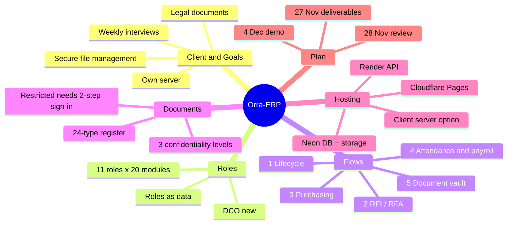

# Orra-ERP — Start Here

> [!summary] What this vault is
> The working notes for **Orra-ERP**, the client-use version of EasyConstruct for ORRA Construction: a secure, enterprise-ready file and project management system that can hold legal documents and run on the client's own server. Demo to the client in the first week of December 2026 (Fri 4 Dec). Refactored weekly from client interviews.
> Sibling vault: the thesis version lives in the EasyConstruct wiki ([[02 Thesis vs Client Version]]).
> Visual version: **[[Orra-ERP Mind Map.canvas]]**

## Notes
- [[01 Client and Goals]]
- [[02 Thesis vs Client Version]]
- [[03 Roles and Permissions]]
- [[04 Flows, Forms and Screens]]
- [[05 Documents and Confidentiality]]
- [[06 Client-Driven Changes]]
- [[07 Hosting and Infrastructure]]
- [[08 Open Questions]]
- [[09 Plan to December Demo]]
- [[10 Deliverables]]
- [[11 Assumptions Awaiting Confirmation]]
- [[12 Repo and Working Rules]]
- [[13 Google Drive Integration]]
- [[14 System Flowchart]]
- [[15 Deploy Wiki to GitHub Pages]]

## Status at a glance (21 Nov 2026)
- Flowchart steps: **21** → 14 already built, 3 need a change, 4 new ([[04 Flows, Forms and Screens]])
- Roles: **11** proposed (10 thesis roles reshaped + DCO) across **20** modules; client confirms each cell ([[03 Roles and Permissions]])
- New requirement: Google Drive as the storage repository ([[13 Google Drive Integration]])
- Open interview questions: **17**, first six block the final flowchart and role matrix ([[08 Open Questions]])
- Deliverables due **Fri 27 Nov**, review **Sat 28 Nov** ([[09 Plan to December Demo]])

## Map

