# EasyConstruct / Orra-ERP — Complete System Flowchart

Up: [[00 Start Here]]

> [!info] What this page covers
> Every user action across all 10 roles, mapped through the five main flows of the system. Based on the `thesis-final` branch of EasyConstruct. Gate checks (P1–P5, D1–D3, C1–C6, K1–K4, X1–X6, T1–T3) must pass before a project can advance.

---

## 1. Authentication and Entry

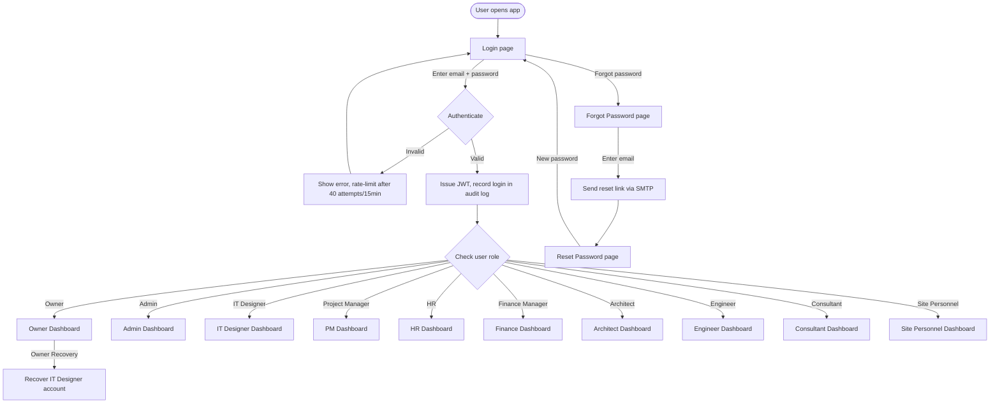

> **Shared pages** accessible to multiple roles: Settings, Archive Search, Completed Workflows, Reports, Blueprint Reviews, HR views, Engineer views, Resources, Requests, Transmittals, Print pages, Legacy Import, AI Validation Reference.

---

## 2. Project Lifecycle (Flow 1)

This is the backbone of the system. A project moves through sequential phases, with gate checks at each transition.

### 2a. Project Creation and Proposal Phase (0–10%)

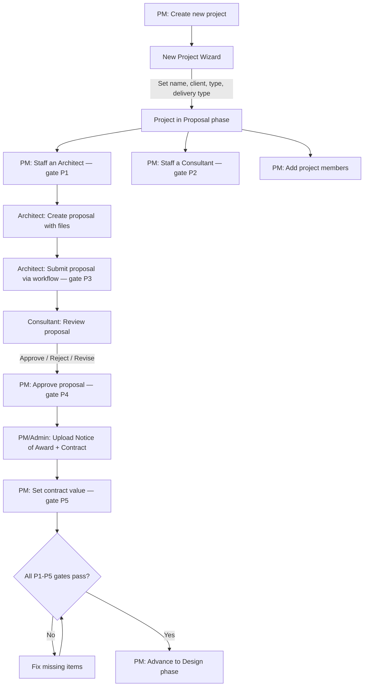

### 2b. Design Phase (10–25%)

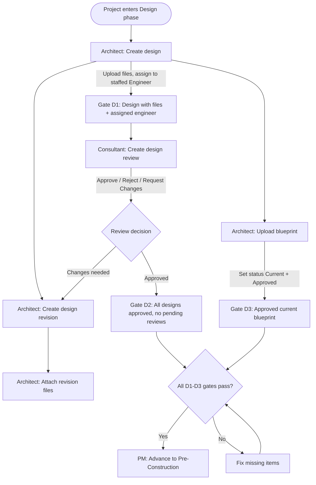

### 2c. Pre-Construction Phase (25–30%)

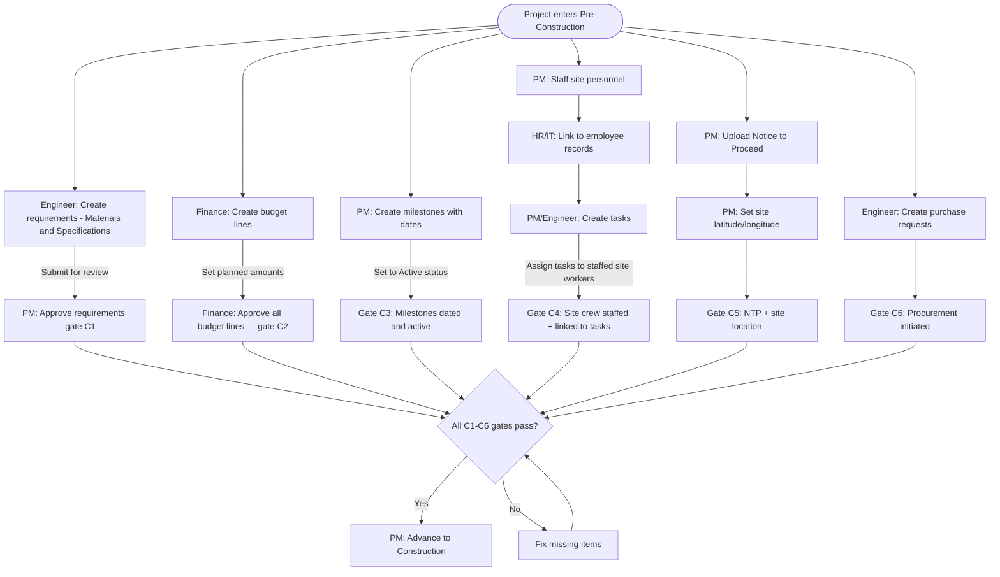

### 2d. Construction Phase (30–95%, progress from tasks)

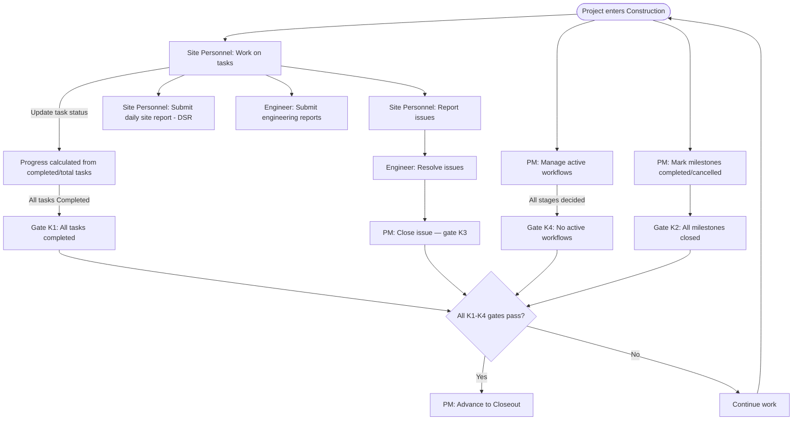

### 2e. Closeout Phase (95–99%)

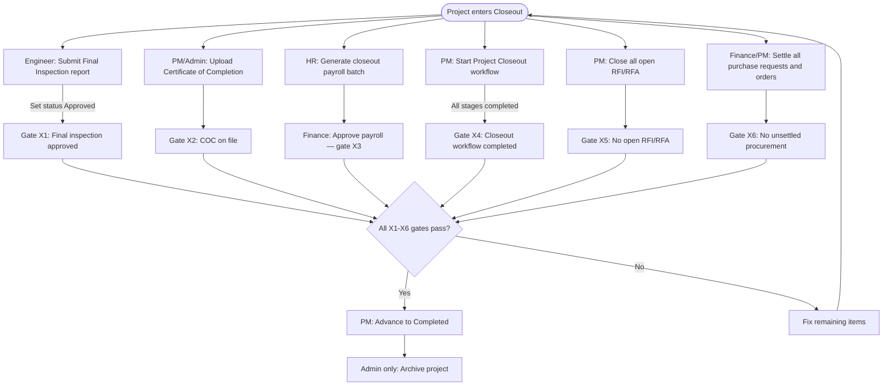

### 2f. Special Transitions

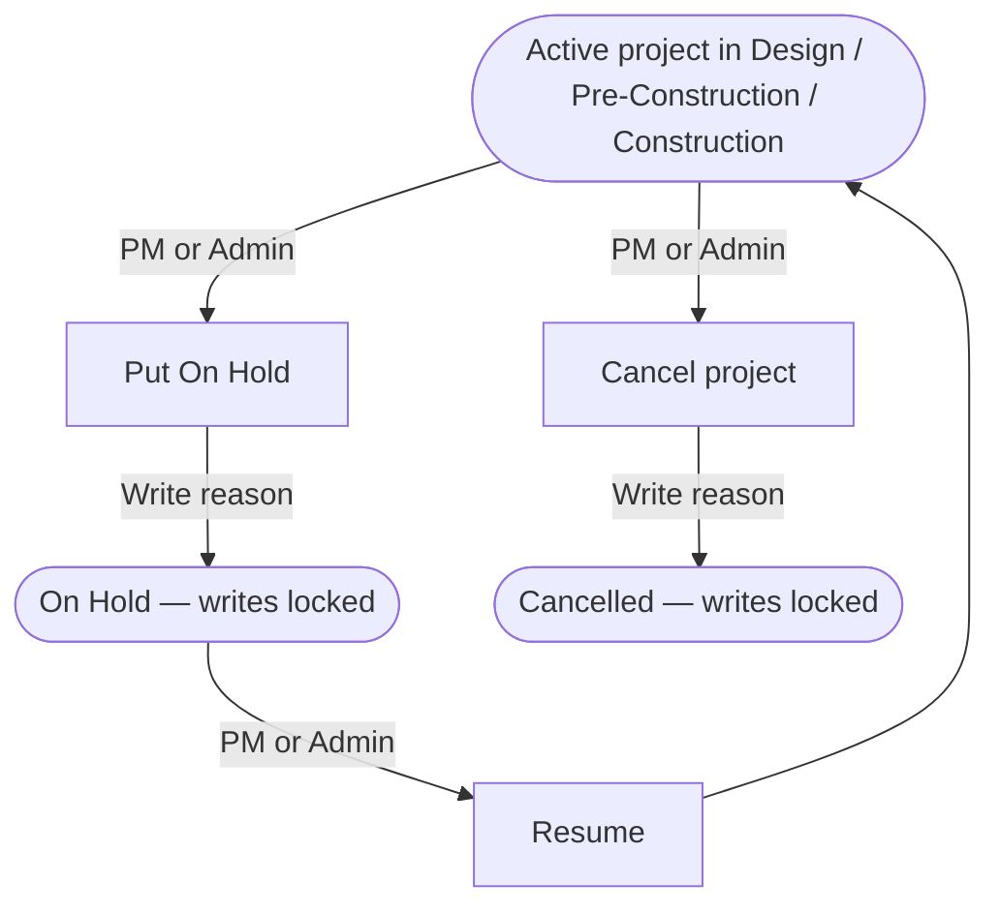

### 2g. Design Delivery Track (Plan Sets Only)

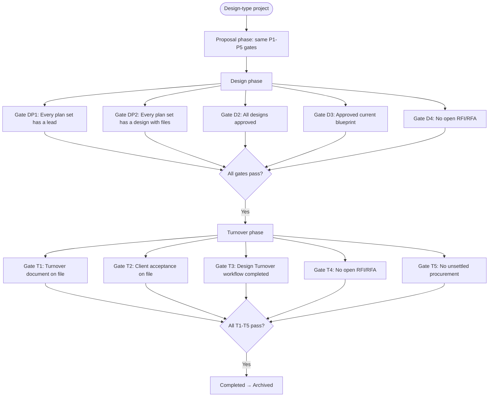

---

## 3. RFI / RFA Flow (Flow 2)

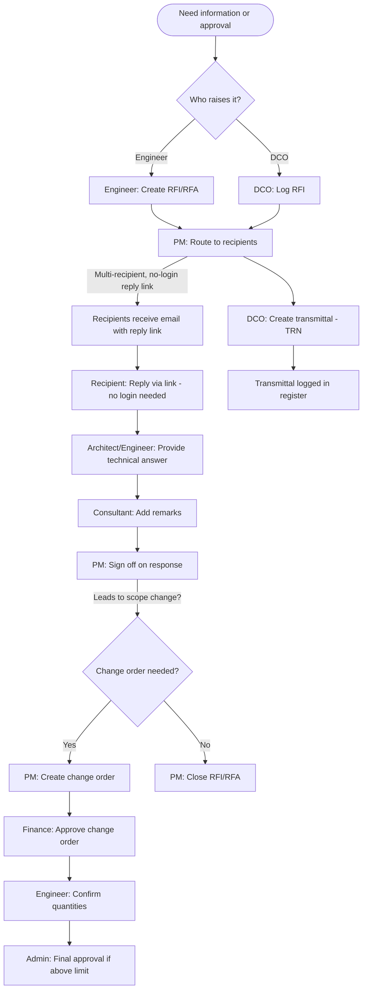

---

## 4. Purchasing Flow (Flow 3)

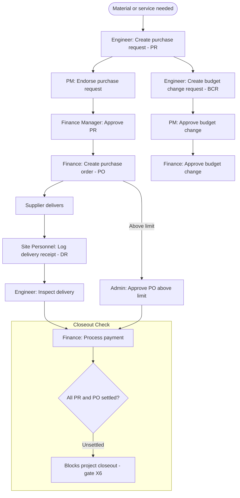

---

## 5. Attendance and Payroll Flow (Flow 4)

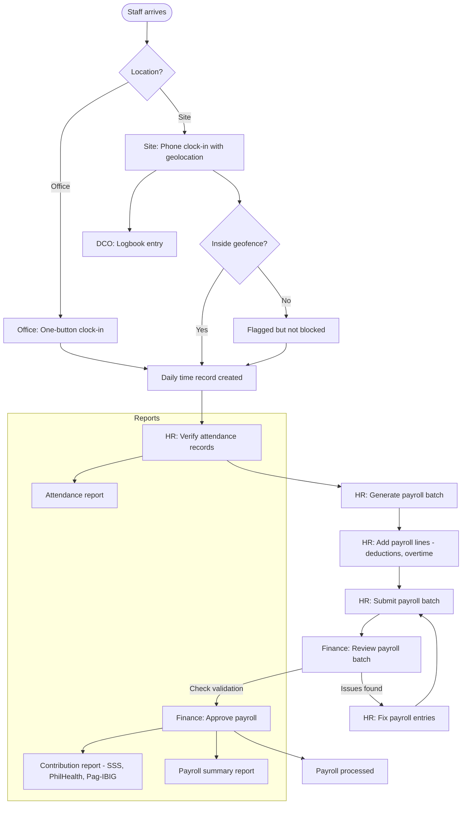

---

## 6. Secure Document Vault Flow (Flow 5)

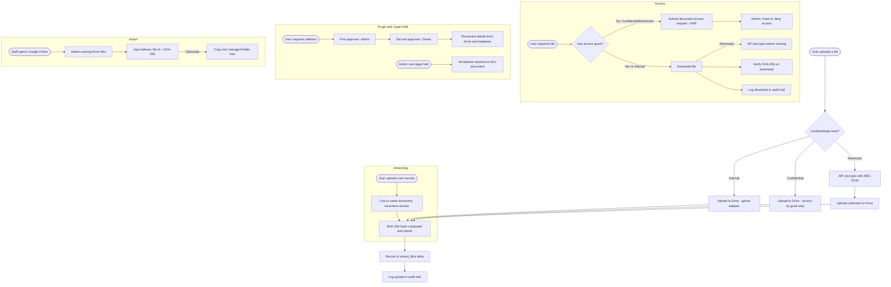

---

## 7. Workflow Engine (Cross-Cutting)

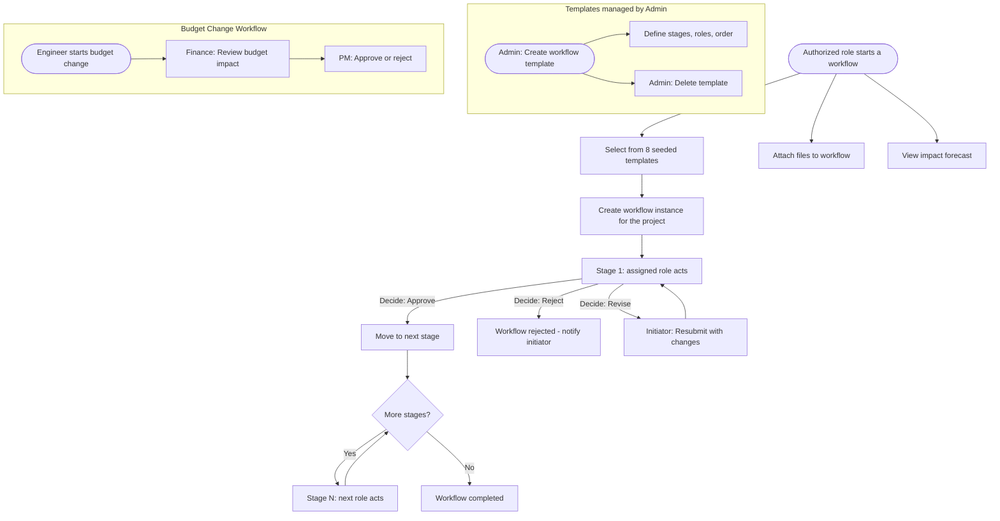

---

## 8. Admin and Platform Actions

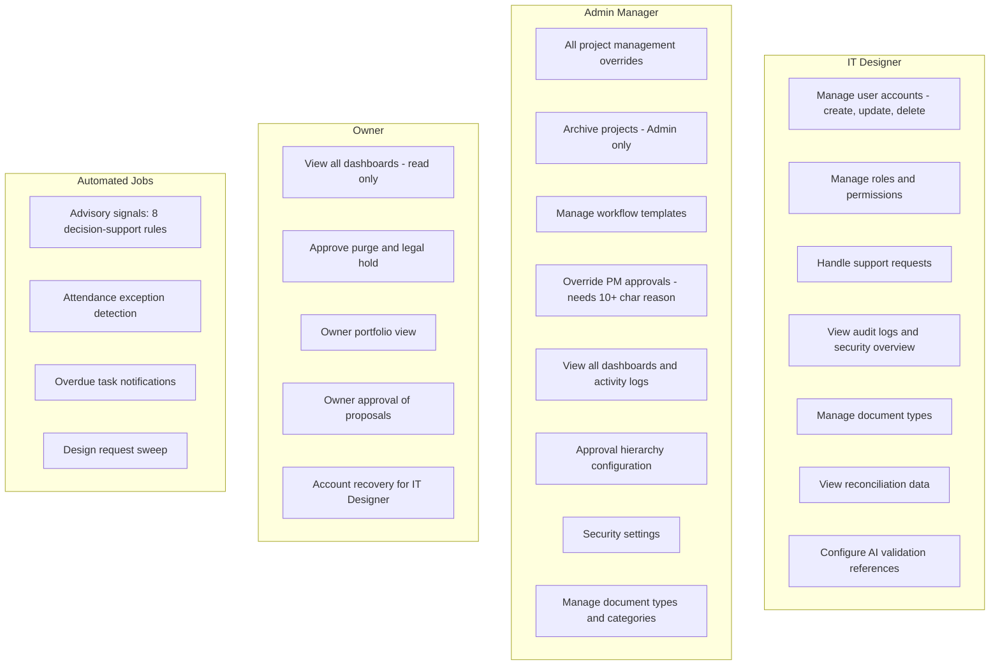

---

## 9. Advisory Decision-Support Signals

The system runs 8 signal rules as background jobs, surfaced on dashboards:

| Signal | What it detects | Who sees it |
|---|---|---|
| Cost variance | Actual vs planned budget divergence | Finance, PM, Admin |
| Cumulative change impact | Total change orders as % of contract | PM, Admin |
| Burn vs progress | Money spent vs % complete | Finance, PM |
| Issue recurrence | Same issue category repeating | Engineer, PM |
| Stalled stage | Workflow stage stuck past threshold | Current stage owner |
| Projected finish | Estimated completion vs deadline | PM, Admin |
| Overdue tasks | Tasks past their due date | Site Personnel, PM |
| Milestone slip | Milestone behind estimated date | PM, Admin |

---

## 10. Role Action Summary

| Role | Creates | Approves / Decides | Views |
|---|---|---|---|
| **Owner** | — | Purge, legal hold, proposals | All dashboards (read-only), portfolio |
| **Admin** | Workflow templates, document types | Phase override, archive, PO above limit, admin override with reason | All projects, activity logs, security |
| **IT Designer** | User accounts, roles, permissions | Support requests | Audit logs, security, reconciliation |
| **Project Manager** | Projects, milestones, tasks, change orders, reports | Proposals, requirements, RFI routing, budget changes, design reviews, phase advance | Staffed projects, approvals |
| **HR** | Payroll batches, employee records, attendance | Attendance verification | Workforce, attendance |
| **Finance Manager** | Budget lines, POs, payments | PR, budget changes, payroll, expense reports | Budget, expenses, profitability |
| **Architect** | Proposals, designs, blueprints, revisions | RFI answers, plan set leads | Staffed projects, documentation |
| **Engineer** | Requirements, purchase requests, tasks, issues, reports | Delivery inspection, budget change requests | Staffed projects, issues |
| **Consultant** | Design reviews, advisory docs | Proposal review, design review, RFI remarks | Staffed projects, proposals |
| **Site Personnel** | DTR (attendance), daily site reports, deliveries | Task status updates | Own tasks, own attendance |
| **DCO** | RFI logs, transmittals, logbook entries | — | Staffed projects |

---

Related: [[03 Roles and Permissions]] · [[04 Flows, Forms and Screens]] · [[08 Open Questions]]